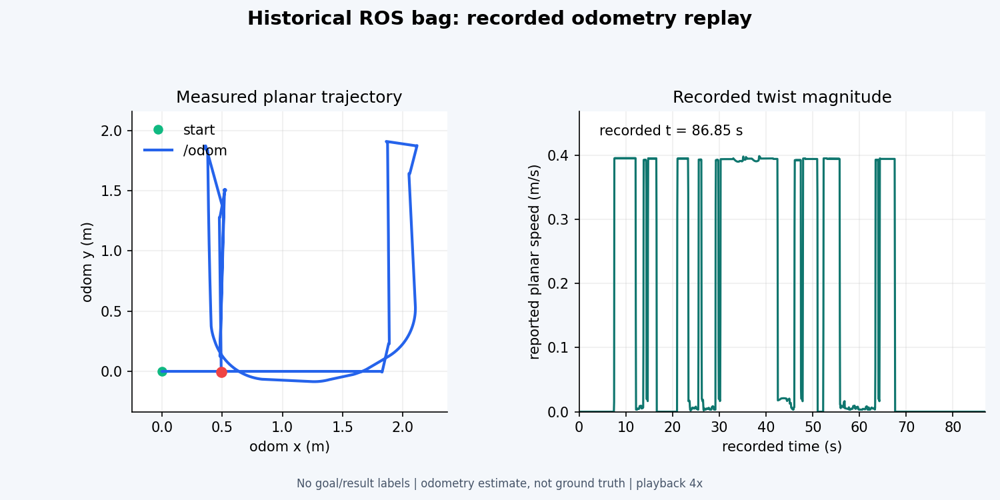
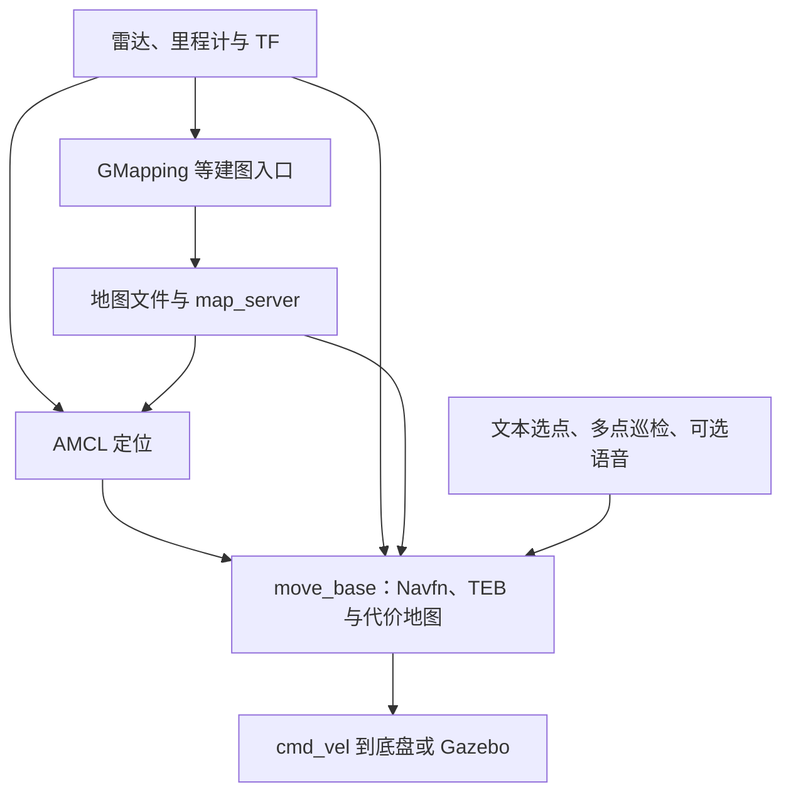

# robot_vechile：ROS 1 导航与多点巡检

基于 ROS Noetic 的移动机器人工作空间，集成二维建图、AMCL 定位、`move_base` 全局/局部规划、文本选点与多点巡检。仿真主线使用 **Navfn + TEB**；语音交互通过可选的讯飞 AIUI 模块接入。

**当前状态：已有代码、地图和两份历史 rosbag；已补齐离线验证与实测采集工具。仓库尚未包含可独立复现整套仿真的机器人模型/世界资源，也没有足以计算巡检成功率或 TEB 提升幅度的成对测试记录。** 这是 ROS 1 工程，运行入口不是 ROS 2 Nav2。

## 演示与可验证成果

[](docs/media/historical_odometry.mp4)

[观看历史数据回放视频（默认 4 倍速）](docs/media/historical_odometry.mp4)。视频逐帧取自仓库已有 `/odom` 记录，展示轨迹及速度；**不是本次新跑的 Gazebo 导航录像，不证明巡检成功或无碰撞**。该 bag 名称包含 `gazebo`，但缺少环境版本清单，环境来源仍应由原始测试者确认。

| 已有证据 | 从原始数据实际读出的结果 | 能证明什么 |
|---|---|---|
| `src/bobac3_slam/bobac3_gazebo_macth.bag` | 86.900 秒；13,838 条消息；1,704 条 `/odom`；里程计轨迹长 13.894689197 米 | 存在可读取的运动、雷达和 IMU 记录 |
| `2025-11-26-20-20-02.bag` | 67.442 秒；5,128 条消息；832 条 `/cmd_vel`；记录中线速度命令全为 0 | 可检查当次命令和 TF；不能当作平移导航成功演示 |
| 巡检成功率 / TEB 调参性能提升 | **暂无可发布的实测结果** | 两份 bag 均缺少导航目标/结果及成对参数快照 |

原始文件 SHA-256、话题数量、测量定义见 [实测证据说明](docs/RESULTS.md) 和 [机器可读结果](benchmarks/results/historical_bags.json)。旧文档中的“通过能力提升 46%”已撤回：它没有对应实测记录。

## 项目架构



建图和基于已有地图的定位是不同运行阶段。导航阶段的主要 TF 链为 `map → odom → base_footprint → 传感器`：AMCL 维护全局定位修正，底盘/仿真提供里程计与传感器外参。`move_base` 的全局规划器给出路径，TEB 根据局部障碍与运动约束生成速度命令；这些算法本身来自上游 ROS 软件。

| 路径 | 作用 / 当前定位 |
|---|---|
| `src/bobac3_navigation/` | 仿真与实机导航入口、地图、AMCL / Navfn / TEB / costmap 配置；本 README 的主线 |
| `src/bobac3_slam/` | GMapping、Cartographer、RTAB-Map 等历史入口；需要分别补齐依赖 |
| `src/nav_goal/` | 单点、多点和文本导航；默认可关闭语音 SDK 依赖 |
| `src/bobac3_audio/`、`src/bobac3_msgs/` | 可选语音服务、SDK 封装及消息定义 |
| `src/oryxbot_navigation/`、`src/oryxbot_slam/` | 另一套平台的历史配置，不与 bobac3 启动链混用 |
| `src/robot_*`、`src/*_pkg/` | 底盘实验、ROS 通信练习和辅助包，非巡检评测入口 |
| `param/` | 未被主线 launch 加载的历史参数，保留作来源记录 |
| `scripts/`、`benchmarks/`、`docs/` | 离线审计、真实巡检采集、配对统计、证据及部署说明 |

**生效参数位置：** `demo_nav_2d.launch → move_base_sim.launch → src/bobac3_navigation/param/sim/`。不要只修改仓库根目录的 `param/` 后就认为配置已生效。节点名称为 `/move_base_node`，导航 Action 名称为 `/move_base`，两者用途不同。

## 运行环境与外部依赖

| 用途 | 目标环境 | 验证范围 |
|---|---|---|
| 复现历史 ROS 工程 | Ubuntu 20.04、ROS Noetic、Gazebo Classic 11、C++11 | 源码和旧路径指向 Noetic；本次未完成 ROS 编译/仿真运行 |
| 离线 bag 审计与视频生成 | Python 3.10+；本次使用 Ubuntu 24.04 / Python 3.12；视频需 FFmpeg | 已实际运行 |
| 可选语音 | AIUI 配置、有效服务权限、ALSA；现存 SDK 库为 x86-64 | 本次仅核对文件来源线索及消息命名空间，未验证云服务 |

ROS Noetic 已于 [2025-05-31 结束官方支持](https://discourse.ros.org/t/ros-noetic-end-of-life-may-31-2025/43160)。这里保留历史复现目标，不承诺该工程能直接在 Ubuntu 24.04 的 ROS 2 环境构建。

完整仿真还缺少 `bobac3_description`、匹配的机器人与世界模型资源；实机入口另外依赖 `rei_robot_base`、`rei_ydlidar_nodelet` 等厂商驱动。来源线索、缺失项和安装边界见 [依赖说明](docs/DEPENDENCIES.md)。

## 部署步骤

### 1. 下载并检查

在已有 ROS Noetic 环境的终端中：

```bash
source /opt/ros/noetic/setup.bash
git clone https://github.com/2543719729/robot_vechile.git
cd robot_vechile
python3 scripts/check_workspace.py
```

### 2. 补齐依赖

安装导航主线的标准依赖（需已配置 ROS 软件源）：

```bash
sudo apt update
sudo apt install python3-yaml ros-noetic-navigation ros-noetic-teb-local-planner ros-noetic-gazebo-ros-pkgs
```

从机器人厂商或原始实验环境取得**匹配且有使用权限**的 `bobac3_description` 及 Gazebo 世界/模型资源，将其放入工作空间 `src/`，或先 source 包含它们的 underlay。`bobac3_description/launch/gazebo.launch` 必须存在；本仓库没有可核验的对应模型下载地址，不能用同名空包替代。

```bash
rospack find bobac3_description
python3 scripts/check_workspace.py --runtime
```

若运行检查失败，先按 [依赖说明](docs/DEPENDENCIES.md) 补齐环境；仓库静态检查通过不代表运行依赖已安装。

### 3. 先构建导航主线

```bash
catkin_make -DCATKIN_WHITELIST_PACKAGES="bobac3_navigation;nav_goal" -DNAV_GOAL_WITH_AUDIO=OFF
source devel/setup.bash
```

默认的文本导航会保留文字介绍，不等待 `voice_tts` 服务。已将历史绝对路径的 catkin 入口改成可移植 CMake 文件，并修正地图 YAML 的本机绝对路径。语音构建步骤见 [依赖说明](docs/DEPENDENCIES.md)。

### 4. 启动导航与选点

```bash
roslaunch bobac3_navigation demo_nav_2d.launch map_file_name:=reicom
```

在 RViz 用 `2D Pose Estimate` 给出与 Gazebo 实际起点一致的定位；检查激光与地图、TF 和 `/clock` 后，再在另一个已 source 的终端运行：

```bash
rosrun nav_goal text_nav_node
```

可输入地点名或 `1–5`。地点坐标来自原工程场景，换地图必须重新确认可达位置。原有 `nav_multigoal_node` 是硬编码的双点演示；需要统计成功率时，使用 [真实测试流程](docs/TESTING.md) 中的 `scripts/run_patrol.py`。

## 测试与复现

无需机器人即可复核本次发布的历史数据：

```bash
python3 -m venv .venv
source .venv/bin/activate
python -m pip install -r requirements-audit.txt
python scripts/check_workspace.py
python -m unittest discover -s tests -v
python scripts/audit_bags.py --check
python scripts/render_bag_replay.py
```

最后一步还需要系统已安装 `ffmpeg`。离线虚拟环境用于审计；执行 ROS 节点时应退出该虚拟环境，使用 Noetic 的 Python 环境。

GitHub Actions 会检查仓库结构、统计工具和原始 bag 的可复算性，并在 Noetic 容器中构建无语音依赖的导航客户端；以 Actions 的实际结果为准，**不把这些检查算作导航任务成功率**。新实验流程包含统一路线、参数快照、失败/超时保留与严格配对，见 [TESTING.md](docs/TESTING.md)。

## 个人贡献与第三方边界

维护者：**李亚鑫 / [2543719729](https://github.com/2543719729)**。根据维护者说明，个人工作重点为 **TEB 参数调试与导航链路集成**。仓库保留了局部规划、代价地图、文本选点和多点巡检的相关实现与配置，可据此展示工程工作；不能据此声称原创实现了 AMCL、Navfn、TEB 或厂商 SDK。

| 工作内容 | 可检查的材料 | 目前证据边界 |
|---|---|---|
| TEB 参数调试 | `src/bobac3_navigation/param/sim/teb_local_planner_params.yaml`，参数来源清单 | 可比较参数；没有实测 A/B 提升结论 |
| 导航与任务接入 | `src/nav_goal/src/`、导航 launch 与 TF/话题配置 | 可审阅代码；历史单次导入提交无法逐行区分所有作者 |
| 本次仓库整理 | README、部署修复、第三方清单、历史数据回放、测试与统计工具 | 由本次整理提交单独追踪；不冒充历史比赛成果 |

## 许可证与致谢

本仓库**尚未确认统一的再分发许可**，13 个原有 ROS 包的 `<license>TODO</license>` 仍是待确认事项。JsonCpp 头文件声明 MIT / Public Domain，已补回对应版本的上游许可文本。厂商组件、讯飞 SDK、来源不明的辅助实现分别列在 [第三方清单](THIRD_PARTY_NOTICES.md)，不能统一套用 MIT。

详见 [许可状态](LICENSE.md)。感谢 ROS Navigation、TEB、JsonCpp 及机器人厂商提供的基础组件。
