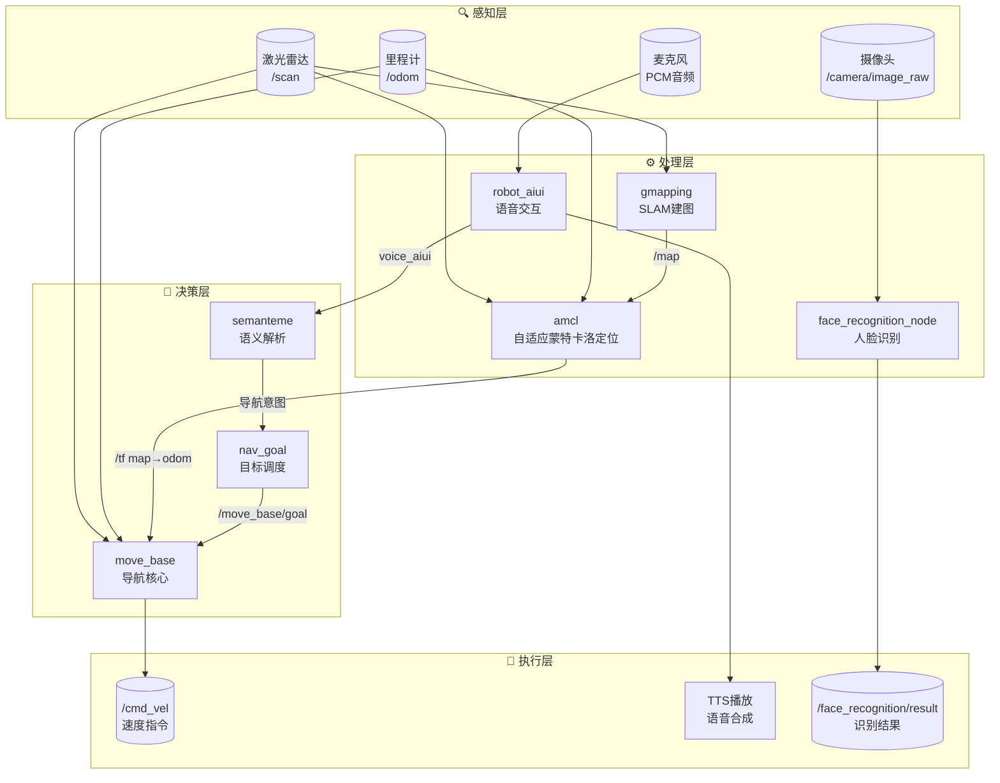
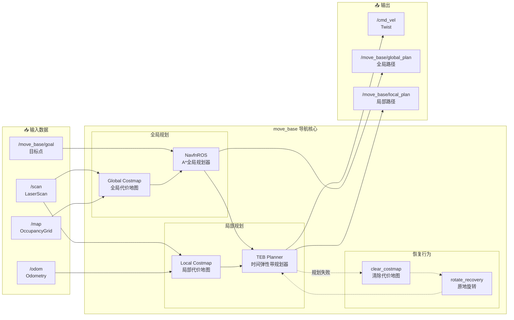
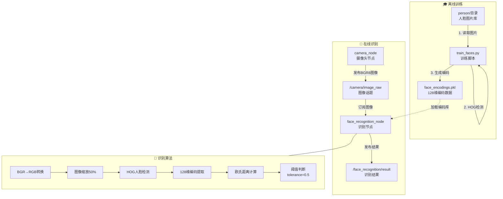
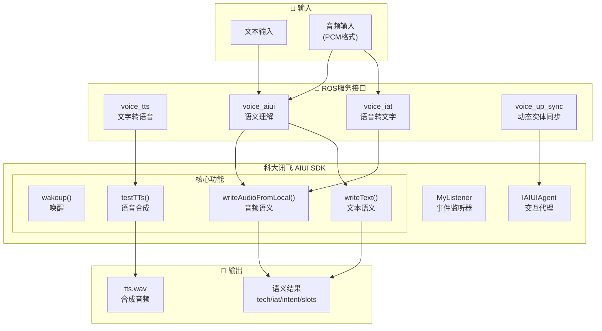
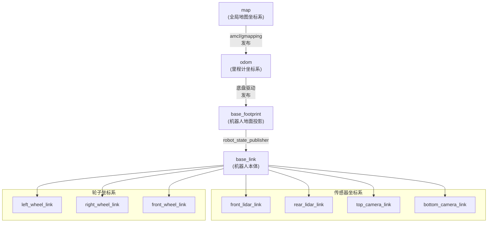
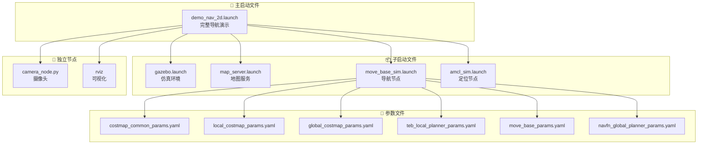
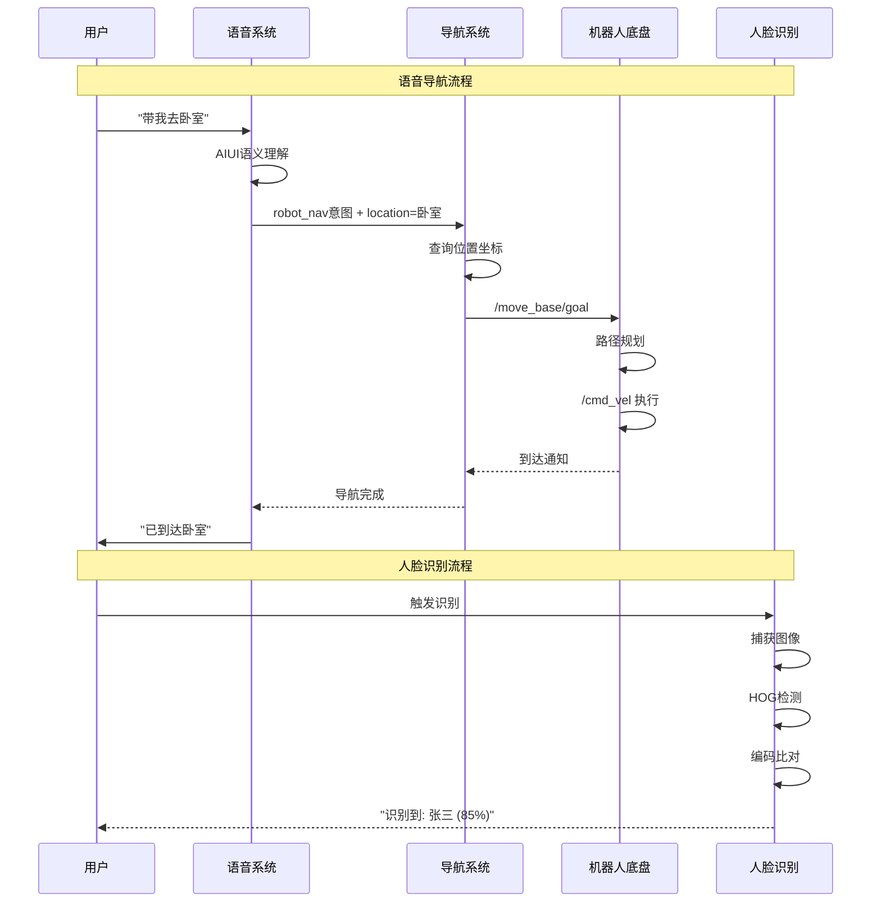
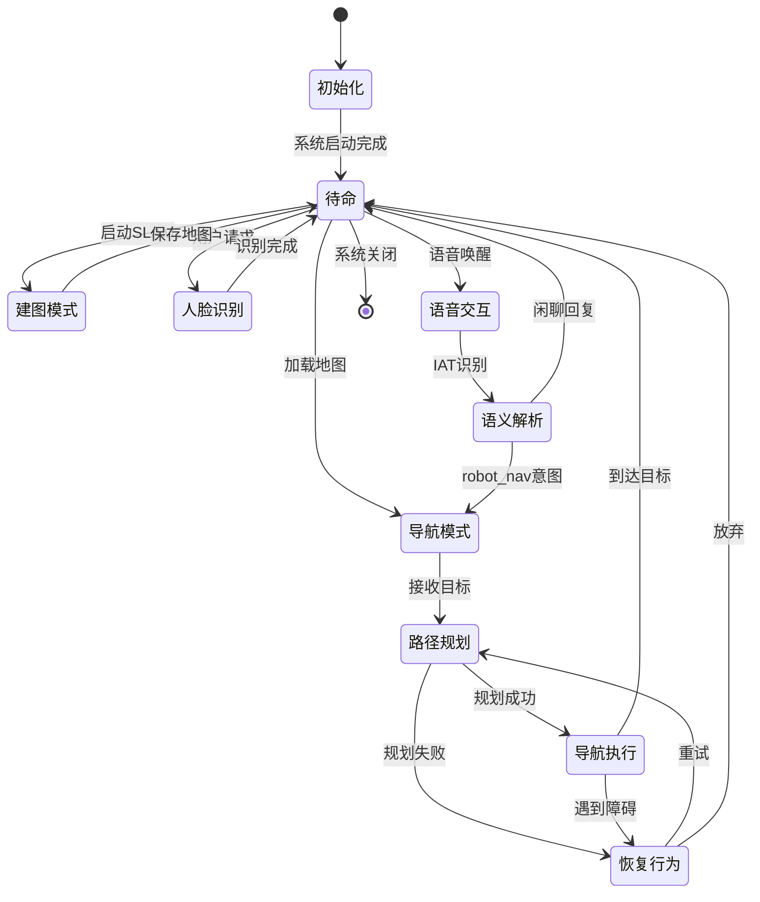

# Bobac3 机器人系统节点架构图

本文档提供系统各模块之间的详细节点通信关系图，使用Mermaid格式绘制。

---

## 1. 整体系统架构

---

## 2. 导航系统详细架构

---

## 3. 人脸识别系统架构

---

## 4. 语音交互系统架构

---

## 5. TF坐标变换树

---

## 6. Launch文件依赖关系

---

## 7. 数据流向图

---

## 8. 系统状态机

---

## 附录：节点清单

### A. 核心节点

| 节点名 | 包名 | 类型 | 功能 |
|-------|-----|------|------|
| `move_base_node` | move_base | C++ | 导航核心 |
| `amcl` | amcl | C++ | 定位 |
| `map_server` | map_server | C++ | 地图服务 |
| `robot_state_publisher` | robot_state_publisher | C++ | TF发布 |

### B. 自定义节点

| 节点名 | 包名 | 类型 | 功能 |
|-------|-----|------|------|
| `camera_node` | face_recognition_pkg | Python | 摄像头 |
| `face_recognition_node` | face_recognition_pkg | Python | 人脸识别 |
| `robot_aiui` | bobac3_audio | C++ | 语音交互 |
| `nav_goal` | nav_goal | C++ | 单点导航 |
| `nav_multigoal` | nav_goal | C++ | 多点巡检 |
| `semanteme` | bobac3_audio | C++ | 语义测试 |

### C. 仿真节点

| 节点名 | 包名 | 类型 | 功能 |
|-------|-----|------|------|
| `gazebo` | gazebo_ros | C++ | 物理仿真 |
| `spawn_model` | gazebo_ros | C++ | 模型加载 |
| `rviz` | rviz | C++ | 可视化 |

---

*图表版本: 1.0*  
*更新日期: 2025-11-28*

> 💡 **提示**: 本文档中的Mermaid图表可在支持Mermaid的Markdown查看器中渲染（如GitHub、VS Code + Mermaid插件、Typora等）。
