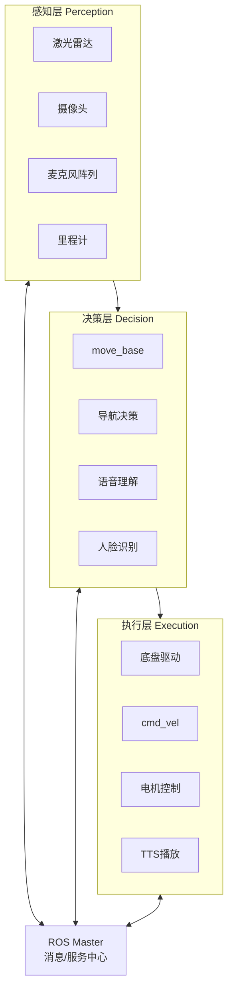
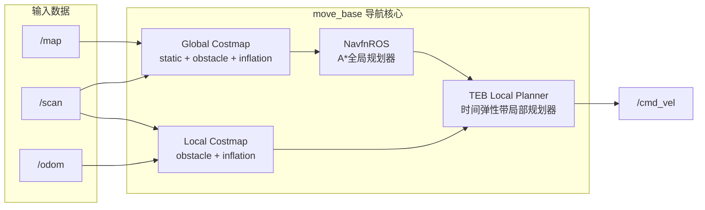
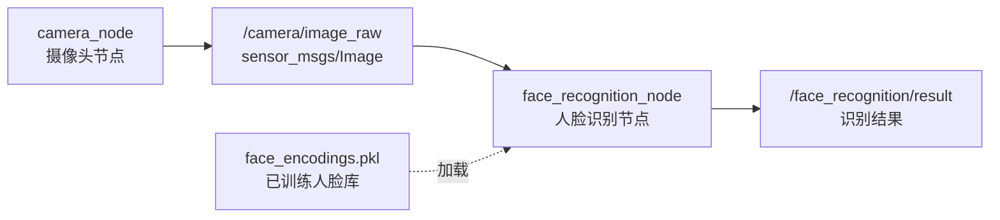
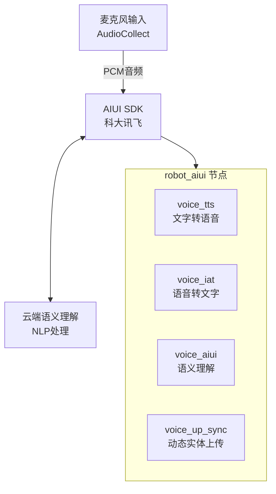
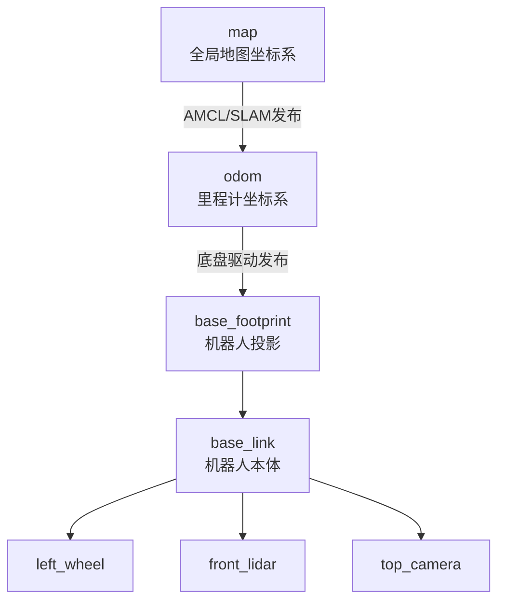
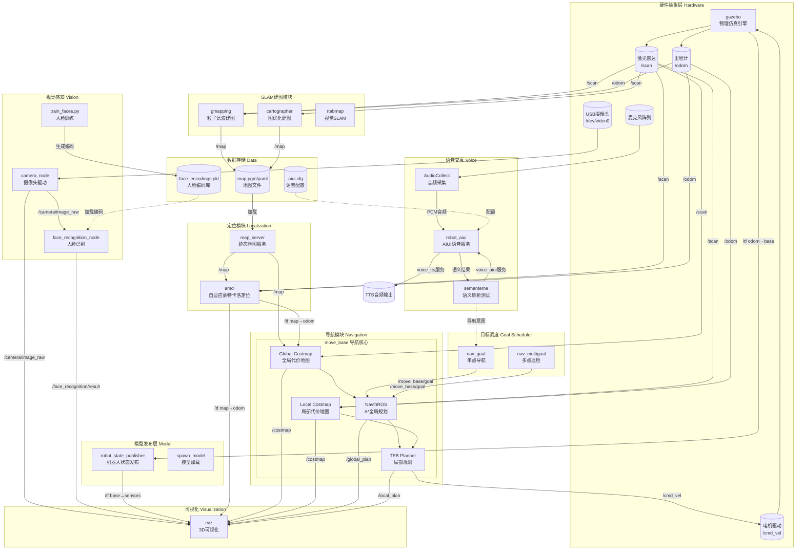
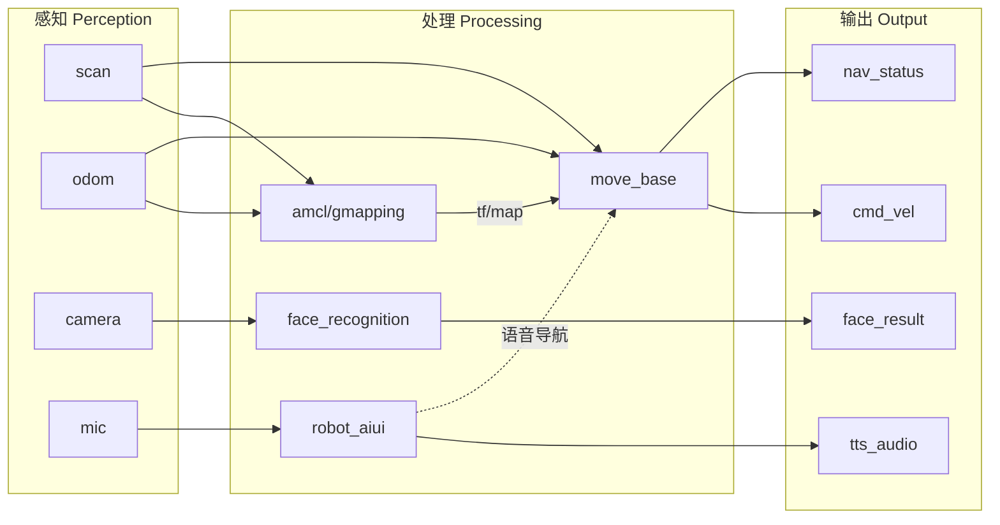

# Bobac3 服务机器人系统技术文档

## 目录
1. [系统概述](#1-系统概述)
2. [系统架构图](#2-系统架构图)
3. [导航系统](#3-导航系统)
4. [人脸识别系统](#4-人脸识别系统)
5. [语音交互系统](#5-语音交互系统)
6. [SLAM建图系统](#6-slam建图系统)
7. [机器人模型描述](#7-机器人模型描述)
8. [消息与服务定义](#8-消息与服务定义)
9. [节点通信关系图](#9-节点通信关系图)
10. [快速启动指南](#10-快速启动指南)

---

## 1. 系统概述

### 1.1 项目简介
本项目是基于ROS (Robot Operating System) 的 **Bobac3 服务机器人** 系统，集成了自主导航、人脸识别、语音交互等多种功能，适用于室内服务场景。

### 1.2 主要功能包

| 功能包名称 | 功能描述 |
|-----------|---------|
| `bobac3_description` | 机器人URDF模型描述与Gazebo仿真 |
| `bobac3_navigation` | 自主导航（路径规划、避障、定位） |
| `bobac3_slam` | SLAM建图（Gmapping、Cartographer） |
| `bobac3_audio` | 语音交互（科大讯飞AIUI） |
| `bobac3_msgs` | 自定义消息和服务类型 |
| `face_recognition_pkg` | 人脸识别与摄像头管理 |
| `nav_goal` | 导航目标发布（单点/多点巡检） |

### 1.3 技术栈
- **ROS版本**: ROS Noetic / Melodic
- **仿真环境**: Gazebo
- **编程语言**: C++, Python3
- **深度学习**: face_recognition (dlib)
- **语音SDK**: 科大讯飞AIUI

---

## 2. 系统架构图



---

## 3. 导航系统

### 3.1 导航系统架构

导航系统基于ROS Navigation Stack实现，主要包含以下组件：



### 3.2 定位系统 (AMCL)

**自适应蒙特卡洛定位** (Adaptive Monte Carlo Localization) 是本系统采用的定位方案。

**文件位置**: `src/bobac3_navigation/launch/amcl_sim.launch`

**核心参数**:
```yaml
# 里程计模型
odom_model_type: omni-corrected    # 全向移动机器人模型

# 粒子滤波参数
min_particles: 500                  # 最小粒子数
max_particles: 2000                 # 最大粒子数
kld_err: 0.05                       # KLD采样误差
kld_z: 0.99                         # KLD置信度

# 激光模型
laser_model_type: likelihood_field  # 似然场模型
laser_max_beams: 60                 # 最大光束数
laser_max_range: 12.0               # 最大测量距离

# 更新阈值
update_min_d: 0.25                  # 平移阈值 (米)
update_min_a: 0.2                   # 旋转阈值 (弧度)
```

### 3.3 全局规划器 (NavfnROS)

使用Dijkstra/A*算法在全局代价地图上规划路径。

**文件位置**: `src/bobac3_navigation/param/navfn_global_planner_params.yaml`

```yaml
NavfnROS:
  visualize_potential: false    # 不可视化势场
  allow_unknown: false          # 不允许穿越未知区域
  default_tolerance: 0.0        # 目标容差
```

### 3.4 局部规划器 (TEB Local Planner)

**时间弹性带** (Timed Elastic Band) 局部规划器，优化局部轨迹实现平滑运动。

**文件位置**: `src/bobac3_navigation/param/sim/teb_local_planner_params.yaml`

**关键参数**:
```yaml
TebLocalPlannerROS:
  # 机器人运动学
  max_vel_x: 0.3                # 最大前进速度 (m/s)
  max_vel_y: 0.3                # 最大横向速度 (全向)
  max_vel_theta: 0.5            # 最大角速度 (rad/s)
  
  # 目标容差
  xy_goal_tolerance: 0.05       # 位置容差 5cm
  yaw_goal_tolerance: 0.15      # 角度容差 ~8.6°
  
  # 障碍物处理
  min_obstacle_dist: 0.26       # 最小障碍物距离
  inflation_dist: 0.35          # 膨胀距离
  
  # 足迹模型
  footprint_model:
    type: "point"               # 点模型，依赖costmap做碰撞检测
```

### 3.5 代价地图配置

#### 全局代价地图
**文件**: `param/global_costmap_params.yaml`
```yaml
global_costmap:
   global_frame: map
   robot_base_frame: base_footprint
   plugins:
     - {name: static_layer,    type: "costmap_2d::StaticLayer"}
     - {name: obstacle_layer,  type: "costmap_2d::VoxelLayer"}
     - {name: inflation_layer, type: "costmap_2d::InflationLayer"}
```

#### 局部代价地图
**文件**: `param/local_costmap_params.yaml`
```yaml
local_costmap:
   global_frame: odom
   rolling_window: true         # 滚动窗口
   width: 3.0                   # 窗口宽度 (米)
   height: 3.0                  # 窗口高度 (米)
   resolution: 0.05             # 分辨率 5cm
```

### 3.6 导航目标发送

#### 单点导航
**文件**: `src/nav_goal/src/nav_goal.cpp`

```cpp
// 使用actionlib发送导航目标
actionlib::SimpleActionClient<move_base_msgs::MoveBaseAction> ac("move_base", true);
move_base_msgs::MoveBaseGoal goal;
goal.target_pose.header.frame_id = "map";
goal.target_pose.pose.position.x = 2.0;
goal.target_pose.pose.position.y = 0.0;
ac.sendGoal(goal);
```

#### 多点巡检
**文件**: `src/nav_goal/src/nav_multigoal.cpp`

实现循环巡检多个预设点位的功能。

---

## 4. 人脸识别系统

### 4.1 系统架构



### 4.2 摄像头节点

**文件**: `src/face_recognition_pkg/scripts/camera_node.py`

**功能**:
- 捕获USB摄像头图像
- 支持WSL2环境 (V4L2 + MJPEG)
- 发布ROS图像话题

**关键代码**:
```python
class CameraNode:
    def __init__(self):
        # 参数配置
        self.camera_id = rospy.get_param('~camera_id', 0)
        self.frame_rate = rospy.get_param('~frame_rate', 30)
        
        # 发布图像话题
        self.image_pub = rospy.Publisher('/camera/image_raw', Image, queue_size=1)
        
        # WSL2兼容: 使用V4L2后端和MJPEG格式
        self.cap = cv2.VideoCapture(self.camera_id, cv2.CAP_V4L2)
        self.cap.set(cv2.CAP_PROP_FOURCC, cv2.VideoWriter_fourcc('M','J','P','G'))
```

**发布话题**:
| 话题名 | 类型 | 描述 |
|-------|------|-----|
| `/camera/image_raw` | `sensor_msgs/Image` | BGR8格式原始图像 |

### 4.3 人脸训练

**文件**: `src/face_recognition_pkg/scripts/train_faces.py`

**训练数据结构**:
```
person/
├── person1/
│   ├── 1.jpg
│   ├── 2.jpg
│   └── 张三.txt        # 文件名即为人名
├── person2/
│   ├── 1.jpg
│   └── 李四.txt
└── person3/
    ├── 1.jpg
    └── 韩沐容.txt
```

**训练流程**:
```
1. 遍历person目录下所有子目录
2. 从.txt文件名获取人员姓名
3. 加载图片，使用HOG检测人脸
4. 使用face_recognition生成128维人脸编码
5. 保存编码到face_encodings.pkl
```

**输出文件**: `data/face_encodings.pkl`
```python
{
    "encodings": [128维向量列表],
    "names": [对应人名列表]
}
```

### 4.4 人脸识别节点

**文件**: `src/face_recognition_pkg/scripts/face_recognition_node.py`

**核心算法**:
```python
def recognize_faces(self, frame):
    # 1. 颜色空间转换 BGR -> RGB
    rgb_frame = cv2.cvtColor(frame, cv2.COLOR_BGR2RGB)
    
    # 2. 缩放加速处理
    small_frame = cv2.resize(rgb_frame, (0, 0), fx=0.5, fy=0.5)
    
    # 3. HOG人脸检测
    face_locations = face_recognition.face_locations(small_frame, model="hog")
    
    # 4. 生成人脸编码
    face_encodings = face_recognition.face_encodings(small_frame, face_locations)
    
    # 5. 与已知人脸比对
    for face_encoding in face_encodings:
        distances = face_recognition.face_distance(self.known_encodings, face_encoding)
        min_distance = np.min(distances)
        
        if min_distance < self.tolerance:  # tolerance默认0.5
            name = self.known_names[np.argmin(distances)]
            confidence = (1 - min_distance) * 100
```

**发布话题**:
| 话题名 | 类型 | 描述 |
|-------|------|-----|
| `/face_recognition/result` | `std_msgs/String` | 识别结果（人名列表） |

### 4.5 启动方式

```bash
# 方式1: 完整启动（含摄像头）
roslaunch face_recognition_pkg face_recognition.launch

# 方式2: 仅识别节点（订阅已有图像话题）
roslaunch face_recognition_pkg face_recognition_topic.launch
```

---

## 5. 语音交互系统

### 5.1 系统架构



### 5.2 核心服务

**文件**: `src/bobac3_audio/src/robot_aiui.cpp`

#### 5.2.1 语音合成服务 (TTS)
```cpp
// 服务: voice_tts
bool audio_tts_cb(robot_audio::robot_tts::Request &req,
                  robot_audio::robot_tts::Response &res)
{
    m_talker.wakeup();
    int temp = m_talker.testTTs("./AIUI/audio/tts.wav", req.text);
    if(temp) {
        res.audiopath = "./AIUI/audio/tts.wav";
        if(req.play) {
            system("aplay ./AIUI/audio/tts.wav");  // 播放合成音频
        }
        return 1;
    }
    return 0;
}
```

#### 5.2.2 语音识别服务 (IAT)
```cpp
// 服务: voice_iat
bool audio_iat_cb(robot_audio::robot_iat::Request &req,
                  robot_audio::robot_iat::Response &res)
{
    Json::Value m_semanteme;
    m_talker.wakeup();
    int temp = m_talker.writeAudioFromLocal(req.audiopath, &m_semanteme);
    if(temp) {
        res.text = m_semanteme["text"].asString();  // 返回识别文本
        return 1;
    }
    return 0;
}
```

#### 5.2.3 语义理解服务 (AIUI)
```cpp
// 服务: voice_aiui
bool audio_semanteme_cb(robot_audio::robot_semanteme::Request &req,
                        robot_audio::robot_semanteme::Response &res)
{
    // mode=1: 文本输入, mode=2: 音频输入
    if(req.mode == 1)
        temp = m_talker.writeText(req.textorpath, &m_semanteme);
    else if(req.mode == 2)
        temp = m_talker.writeAudioFromLocal(req.textorpath, &m_semanteme);
    
    // 解析语义结果
    res.tech = m_semanteme["tech"].asString();     // system/user
    res.iat = m_semanteme["text"].asString();      // 识别文本
    res.anwser = m_semanteme["answer"].asString(); // 回答内容
    res.intent = m_semanteme["intent"].asString(); // 意图
    
    // 特殊意图处理
    if (res.intent == "robot_nav") {
        res.anwser = "好的！现在就带你去" + res.slots_value[1];
    }
}
```

### 5.3 自定义技能意图

| 意图名称 | 触发示例 | 槽位 |
|---------|---------|------|
| `robot_nav` | "带我去卧室" | location: 目的地 |
| `robot_control` | "前进0.2米" | action: 动作, distance: 距离, unit: 单位 |

### 5.4 语义理解示例

**文件**: `src/bobac3_audio/src/semanteme.cpp`

```cpp
// 调用语义理解服务
ros::ServiceClient client = n.serviceClient<bobac3_audio::robot_semanteme>("voice_aiui");

bobac3_audio::robot_semanteme srv;
srv.request.mode = 1;                    // 文本输入模式
srv.request.textorpath = "带我去卧室";    // 输入文本

client.call(srv);

// 解析导航意图
if(srv.response.intent == "robot_nav") {
    // slots_name[1] = "location"
    // slots_value[1] = "卧室"
    std::cout << srv.response.slots_name[1] << ":" << srv.response.slots_value[1];
}
```

---

## 6. SLAM建图系统

### 6.1 支持的SLAM算法

| 算法 | Launch文件 | 特点 |
|------|-----------|------|
| Gmapping | `bobac3_gmapping_sim.launch` | 经典粒子滤波，适合小场景 |
| Cartographer | `bobac3_cartographer_sim.launch` | Google开源，大规模建图 |
| RTAB-Map | `bobac3_rtabmap_sim.launch` | 视觉+激光融合 |

### 6.2 Gmapping配置

**文件**: `src/bobac3_slam/launch/bobac3_gmapping_sim.launch`

```yaml
# 核心参数
base_frame: base_footprint      # 机器人基座坐标系
odom_frame: odom                # 里程计坐标系
map_frame: map                  # 地图坐标系

# 地图参数
map_update_interval: 2.0        # 地图更新间隔 (秒)
delta: 0.05                     # 地图分辨率 (米/像素)

# 激光参数
maxUrange: 15.0                 # 最大有效距离
maxRange: 20.0                  # 最大测量距离

# 粒子滤波参数
particles: 300                  # 粒子数量
minimumScore: 50                # 最小匹配分数

# 运动模型噪声
srr: 0.001                      # 平移-平移噪声
srt: 0.001                      # 平移-旋转噪声
str: 0.001                      # 旋转-平移噪声
stt: 0.001                      # 旋转-旋转噪声
```

### 6.3 建图与保存

```bash
# 启动建图
roslaunch bobac3_slam bobac3_gmapping_sim.launch

# 保存地图
rosrun map_server map_saver -f ~/map_name
```

**输出文件**:
- `map_name.pgm` - 栅格地图图像
- `map_name.yaml` - 地图元数据

---

## 7. 机器人模型描述

### 7.1 坐标系定义



### 7.2 主要Link

| Link名称 | 描述 |
|---------|------|
| `base_link` | 机器人底盘主体 |
| `base_footprint` | 底盘在地面的投影 |
| `front_lidar_link` | 前置激光雷达 |
| `rear_lidar_link` | 后置激光雷达 |
| `top_camera_link` | 顶部摄像头 |
| `left_wheel_link` | 左驱动轮 |
| `right_wheel_link` | 右驱动轮 |

### 7.3 传感器配置

**激光雷达**: 用于SLAM和避障
- 安装位置: 前后各一个
- 扫描范围: 360°
- 最大距离: 15m

**摄像头**: 用于人脸识别
- 分辨率: 640×480
- 帧率: 30fps

### 7.4 仿真启动

**文件**: `src/bobac3_description/launch/gazebo.launch`

```xml
<!-- 加载机器人模型 -->
<param name="robot_description" 
    command="$(find xacro)/xacro $(find bobac3_description)/xacro/bobac3_serverbot.xacro sim:=1"/>

<!-- 在Gazebo中生成机器人 -->
<node name="spawn_model" pkg="gazebo_ros" type="spawn_model"
    args="-param robot_description -urdf -model bobac3_serverbot"/>

<!-- 发布TF -->
<node name="robot_state_publisher" pkg="robot_state_publisher" type="robot_state_publisher"/>
```

---

## 8. 消息与服务定义

### 8.1 自定义消息 (bobac3_msgs/msg)

#### car_data.msg
```
float64[] speed          # 轮子速度
uint16[] crash           # 碰撞传感器
uint16[] infrared        # 红外传感器
uint16[] ultrasonic      # 超声波距离
uint16 smoke             # 烟雾传感器
uint16 power_voltage     # 电源电压
float32[] mpu            # IMU数据
float32 tempareture      # 温度
float32 humidity         # 湿度
```

#### joint.msg
```
float32 L1_angle
float32 L2_angle
float32 R1_angle
float32 R2_angle
```

### 8.2 自定义服务 (bobac3_msgs/srv)

#### SetRelativeMove.srv
```
float32 x
float32 y
float32 theta
---
bool success
```

#### Neck.srv
```
float32 pitch
float32 yaw
---
bool success
```

### 8.3 语音服务 (robot_audio)

#### robot_tts.srv
```
string text        # 待合成文本
bool play          # 是否播放
---
string audiopath   # 音频文件路径
```

#### robot_semanteme.srv
```
int8 mode              # 1=文本, 2=音频
string textorpath      # 文本或音频路径
---
string tech            # system/user
string iat             # 识别文本
string anwser          # 回答内容
string intent          # 意图
string[] slots_name    # 槽位名
string[] slots_value   # 槽位值
```

---

## 9. 节点通信关系图

### 9.0 完整系统节点关系图



### 9.0.1 简化版节点关系图



### 9.1 话题列表

| 话题名 | 类型 | 发布者 | 订阅者 |
|-------|------|-------|-------|
| `/scan` | LaserScan | gazebo/lidar | move_base, amcl, gmapping |
| `/odom` | Odometry | gazebo | move_base, amcl |
| `/cmd_vel` | Twist | move_base | gazebo |
| `/map` | OccupancyGrid | map_server/gmapping | move_base, amcl |
| `/camera/image_raw` | Image | camera_node | face_recognition_node |
| `/face_recognition/result` | String | face_recognition_node | (用户程序) |
| `/move_base/goal` | MoveBaseActionGoal | nav_goal | move_base |
| `/tf` | TFMessage | robot_state_publisher, amcl | 所有节点 |

### 9.2 服务列表

| 服务名 | 类型 | 提供者 |
|-------|------|-------|
| `voice_tts` | robot_tts | robot_aiui |
| `voice_iat` | robot_iat | robot_aiui |
| `voice_aiui` | robot_semanteme | robot_aiui |
| `voice_up_sync` | up_sync | robot_aiui |

---

## 10. 快速启动指南

### 10.1 环境配置

```bash
# 编译工作空间
cd ~/Documents/robot_learning
catkin_make

# 加载环境
source devel/setup.bash
```

### 10.2 启动仿真导航

```bash
# 一键启动: Gazebo + 地图 + 导航 + 摄像头 + RViz
roslaunch bobac3_navigation demo_nav_2d.launch

# 发送导航目标 (另一终端)
rosrun nav_goal nav_goal
```

### 10.3 启动人脸识别

```bash
# 训练人脸 (首次使用)
rosrun face_recognition_pkg train_faces.py

# 启动人脸识别
roslaunch face_recognition_pkg face_recognition.launch
```

### 10.4 启动语音交互

```bash
# 启动语音服务
rosrun bobac3_audio robot_aiui

# 测试语义理解 (另一终端)
rosrun bobac3_audio semanteme
```

### 10.5 SLAM建图

```bash
# 启动建图
roslaunch bobac3_slam bobac3_gmapping_sim.launch

# 保存地图
rosrun map_server map_saver -f ~/my_map
```

---

## 附录

### A. 目录结构
```
robot_learning/
├── src/
│   ├── bobac3_audio/          # 语音交互
│   ├── bobac3_description/    # 机器人模型
│   ├── bobac3_msgs/           # 消息定义
│   ├── bobac3_navigation/     # 导航系统
│   ├── bobac3_slam/           # SLAM建图
│   ├── face_recognition_pkg/  # 人脸识别
│   └── nav_goal/              # 导航目标
├── person/                    # 人脸训练数据
├── param/                     # 参数配置
├── AIUI/                      # 语音SDK资源
└── docs/                      # 文档
```

### B. 依赖库
- ROS Navigation Stack
- Gmapping / Cartographer
- face_recognition (Python)
- 科大讯飞AIUI SDK
- OpenCV
- cv_bridge

---

*文档版本: 1.0*  
*更新日期: 2025-11-28*
